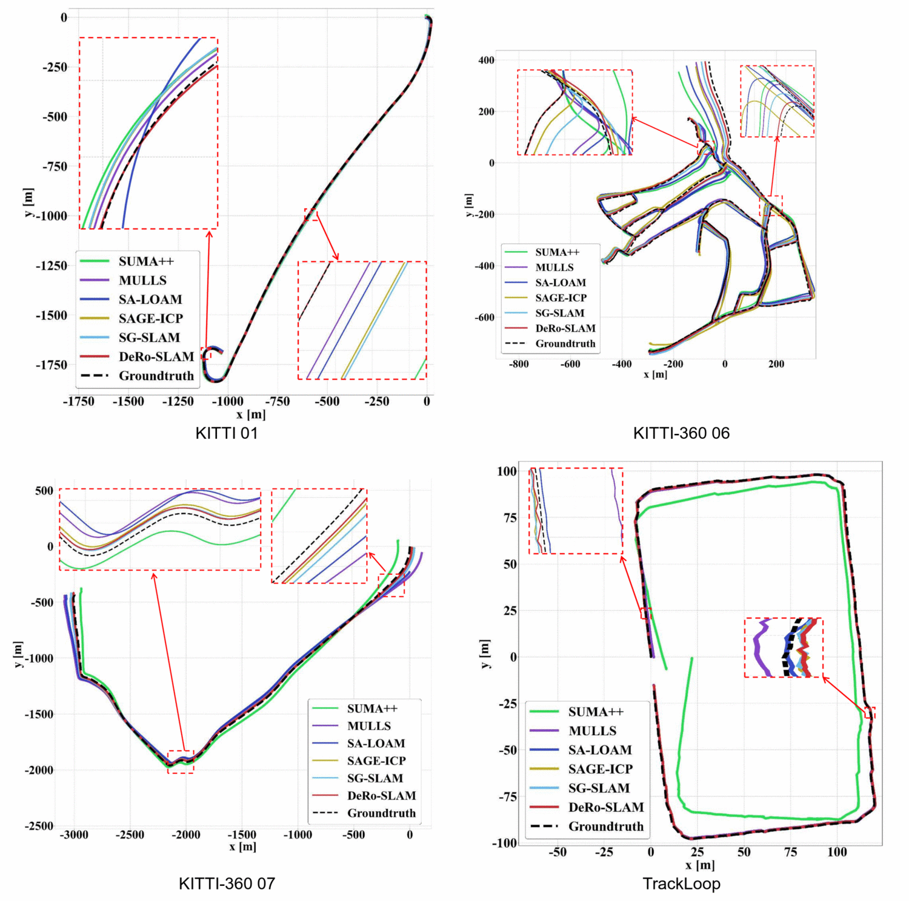
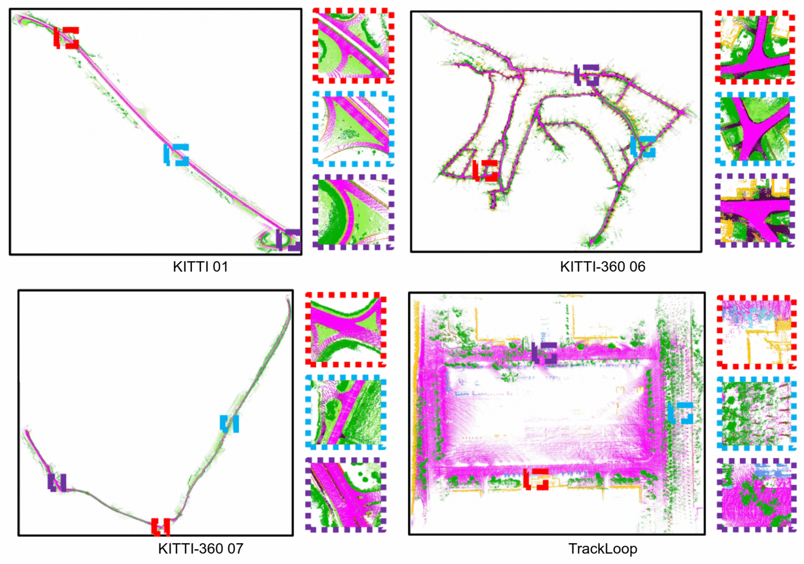
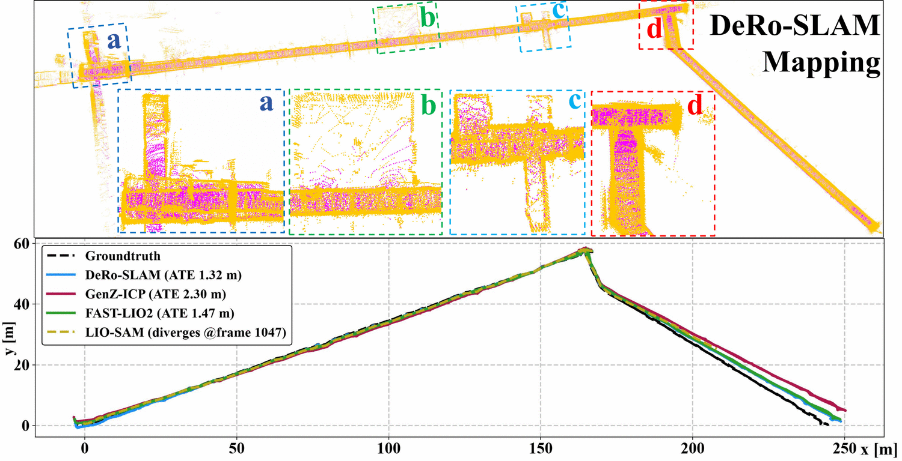

# DeRoS

**Degeneracy-Robust LiDAR SLAM via Semantically Decoupled Registration and
Hierarchical Loop Closure**

DeRoS is a LiDAR SLAM system for geometrically degenerate scenes, where the
visible geometry is dominated by ground planes and building facades. Instead of
relying on Hessian-based criteria evaluated inside the registration loop, it
quantifies scene degeneracy from a bird's-eye-view (BEV) projection of the
semantic scan **before** registration, and switches between 6-DoF joint
registration and ground/non-ground decoupled registration accordingly. Loop
closure uses a four-level descriptor combining global existence, background
structure, foreground instances and location, with scene-adaptive weighting.

> 📦 **This is the release package.** The algorithm core ships as a precompiled
> library (`src/deros_core/lib/libderos_core.so`) with its public headers. The
> ROS application layer (`src/deros`) is plain source and can be read and
> modified freely. The full algorithm source will be released upon publication.

## Results

Evaluated on 22 sequences from KITTI, KITTI-360, TrackLoop and SubT-MRS, and
benchmarked against SUMA++, MULLS, SA-LOAM, SAGE-ICP and SG-SLAM.

### Trajectory comparison

<p align="center">
  
</p>

### Global mapping

<p align="center">
  
</p>

### Average trajectory error

Mean ATE (m) over all sequences of each dataset; bold is best, underlined
second-best. Runtime is offline per-frame latency (ms).

| Dataset | Metric | SUMA++ | MULLS | SA-LOAM | SAGE-ICP | SG-SLAM | **Ours** |
|---|---|---|---|---|---|---|---|
| KITTI | Mean ATE | 3.08 | 1.89 | 3.06 | 1.47 | <u>1.13</u> | **0.80** |
| KITTI | Time (ms) | 13.08 | 16.30 | 45.73 | <u>8.95</u> | **8.55** | 10.84 |
| KITTI-360 | Mean ATE | 17.44 | 19.30 | 27.89 | 12.14 | <u>8.71</u> | **5.15** |
| KITTI-360 | Time (ms) | 17.84 | 22.03 | 42.28 | <u>9.39</u> | **9.30** | 10.97 |
| TrackLoop | ATE | 10.38 | 0.91 | <u>0.50</u> | 0.62 | 0.64 | **0.47** |
| TrackLoop | Time (ms) | **10.19** | <u>10.84</u> | 32.82 | 11.08 | 11.12 | 11.66 |

### Indoor corridors (SubT-MRS)

<p align="center">
  
</p>

In the long indoor corridor sequences DeRoS reaches an ATE of 1.32 m, compared
with 1.47 m for FAST-LIO2 and 2.30 m for GenZ-ICP; LIO-SAM diverges at frame 1047.

## Repository layout

```
.
├── README.md
├── BUILD.md                     build and run instructions
├── docs/figures/                figures used in this document
└── src/
    ├── deros_core/
    │   ├── include/deros_core/  public API headers (data structures only)
    │   ├── include/third_party/ vendored Eigen and Sophus headers
    │   └── lib/                 libderos_core.so
    └── deros/                   ROS application layer
        ├── launch/datasets/     one launch file per dataset
        ├── launch/online/       online semantic input + inference nodes
        ├── scripts/             evaluation and semantic inference scripts
        ├── src/                 OdometryNode / MappingNode
        └── save/                where trajectories and maps are written
```

## Requirements

- Ubuntu 20.04 with ROS Noetic (what the results were produced on)
- OpenCV 4, TBB and the Suitesparse libraries that `libderos_core.so` links
  against:

```bash
sudo apt install libgoogle-glog-dev libsuitesparse-dev libopenblas-dev \
                 libtbb-dev libopencv-dev
```

- GTSAM **4.2.0 built with TBB** (`libgtsam.so.4`) — build it from source as
  shown in [BUILD.md](BUILD.md#gtsam-required); other versions, or a build
  without TBB, fail at link time
- Eigen and Sophus are vendored under `src/deros_core/include/third_party`;
  nothing else has to be installed for them

No GPU is required: the prebuilt library contains no CUDA dependency.

To check that nothing is missing on your machine:

```bash
ldd src/deros_core/lib/libderos_core.so | grep "not found"
```

## Quick start

```bash
catkin_make -j$(nproc)
source devel/setup.bash

# offline: point clouds and labels are read from the bag
roslaunch deros kitti_start.launch sequence:=00
```

Each run writes the odometry and mapping trajectories to
`src/deros/save/evo_log/`, saves the global map to `src/deros/save/map/`, and
prints the ATE metrics when it ends.

See **[BUILD.md](BUILD.md)** for dependencies, the full argument list and the
`run_mode` description.

## Supported datasets

| dataset | launch file |
|---|---|
| KITTI | `kitti_start.launch sequence:=00` |
| KITTI-360 | `kitti360_start.launch sequence:=00` |
| TrackLoop | `trackloop_start.launch` |
| SubT-MRS | `subt_start.launch` |

Launch files for MulRan, Geode and SLABIM are also included under
`src/deros/launch/datasets/`.

Each launch file expects its dataset under `~/data/<dataset>` by default
(`~/data/KITTI`, `~/data/KITTI-360`, `~/data/mulran`, …). If your data lives
elsewhere, pass `database_path:=/your/path` on the command line.

## Test data

A complete sequence is bundled so a first end-to-end run needs nothing but this
repository: KITTI odometry **sequence 04**, 271 frames.

| file | content |
|---|---|
| [kitti04.bag](https://github.com/Jiuchenyan/DeRo-SLAM/releases/download/v0.1.0/kitti04.bag) | `sensor_msgs/PointCloud2` on `/kitti/velo/pointcloud`, per-point semantic labels from Cylinder3D inference (650 MB) |
| [kitti04_gt.txt](https://github.com/Jiuchenyan/DeRo-SLAM/releases/download/v0.1.0/kitti04_gt.txt) | ground-truth poses, one 3×4 matrix per frame |
| [kitti04_calib.txt](https://github.com/Jiuchenyan/DeRo-SLAM/releases/download/v0.1.0/kitti04_calib.txt) | calibration (`P0`–`P3` and `Tr`) used by the evaluation script |

```bash
mkdir -p ~/data/kitti04 && cd ~/data/kitti04
for f in kitti04.bag kitti04_gt.txt kitti04_calib.txt; do
  wget https://github.com/Jiuchenyan/DeRo-SLAM/releases/download/v0.1.0/$f
done

# run + evaluate
roslaunch deros kitti_start.launch sequence:=04 run_mode:=2 \
    launch_bag:=false launch_semantic:=false visualize:=false \
    bag_file:=$HOME/data/kitti04/kitti04.bag \
    save_path:=$HOME/data/kitti04/out/ \
    eval_cmd:="python3 \$(rospack find deros)/scripts/eval/detal_eval_kitti.py \
               --gt_file $HOME/data/kitti04/kitti04_gt.txt \
               --pred_file $HOME/data/kitti04/out/evo_log/kitti_mapping_04.txt \
               --calib_file $HOME/data/kitti04/kitti04_calib.txt"
```

The trajectories land in `~/data/kitti04/out/evo_log/`, the global map in
`~/data/kitti04/out/map/`, and the ATE is printed when the run finishes.

The semantic labels in the bag were produced by running **Cylinder3D**
inference on the raw scans; the **SemanticKITTI ground-truth** labels can be
used instead without regenerating anything, since they share the same encoding. The
`label` field is `uint32`: the class id sits in the low 16 bits and the instance
id, when present, in the high 16 bits — the loader masks it with `0xffff`, so
ground-truth files (which carry instance ids) and pure predictions (which do
not) are both accepted.


## Online semantic mode

Setting `run_mode:=3` replaces the bag reader with a subscriber to a semantic
point cloud topic, so segmentation can come from a live inference node rather
than from pre-labelled data. Launch files in `src/deros/launch/online/` can
start a Cylinder3D, RandLA-Net or SegNet4D node for you:

```bash
roslaunch deros kitti_start.launch run_mode:=3 launch_semantic:=true
```

Each inference backend needs its own Python environment and model weights; set
the paths in the corresponding `src/deros/scripts/run_*.sh`. The reported results
above use offline labels.

## Citation

```bibtex
@article{deros,
  title   = {DeRoS: Degeneracy-Robust LiDAR SLAM via Semantically Decoupled
             Registration and Hierarchical Loop Closure},
  author  = {Anonymous},
  journal = {TBD},
  year    = {TBD}
}
```

## License

Released under the MIT License — see [LICENSE](LICENSE).

The front-end registration code derives from KISS-ICP (MIT, Copyright (c) 2022
Ignacio Vizzo), whose notice is retained in the corresponding source files.

---

<sub>`DeRoS` and `DeRo-SLAM` refer to the same system: *DeRo* is the shortened
project name used in the code and launch files, and the `S` in `DeRoS` stands for
SLAM.</sub>
